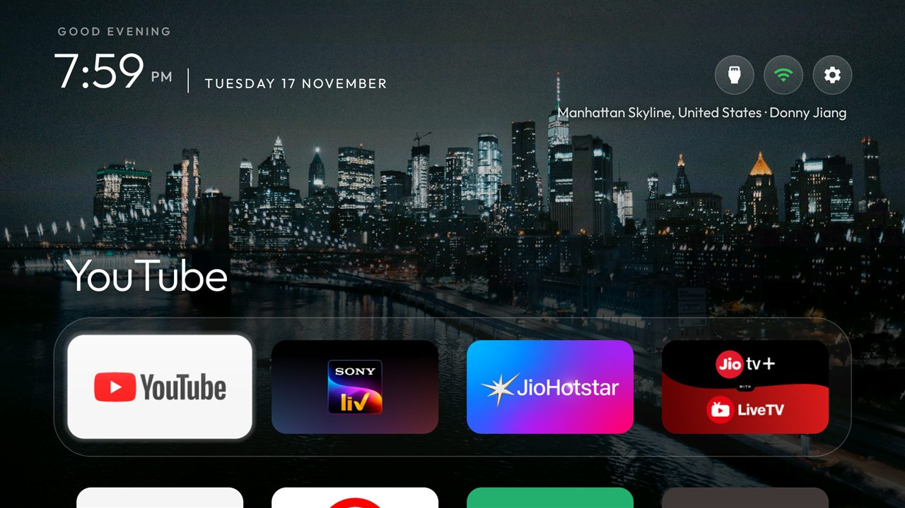

# TV Unsplash wallpapers

A fresh Unsplash photo on your Android TV's Home screen, with the place and the photographer under the buttons.
Out of the box: four landscapes a day matched to the light. You choose how often it changes (1 to 48 times a
day) and what it shows (your own topics, or Unsplash collections). Made for the
[cleanyourtv](https://github.com/Gathin23/cleanyourtv) launcher (`com.gathin.tvhome`): it writes each photo into
the launcher's wallpaper folder and deletes the one before. No app tile, nothing on screen of its own.



The default, 4 a day with no topics set:

| Time | Photos |
|---|---|
| 05:00 - 11:00 | sunrise, misty mornings |
| 11:00 - 16:00 | mountains, lakes, coastlines, the Himalaya |
| 16:00 - 19:00 | sunset, golden hour |
| 19:00 - 05:00 | night sky, the Milky Way, city lights |

## Choose what and how often

Pick these when you run setup, or change them any time later (`-SkipInstall` / `SKIP_INSTALL=1` only sends the
options). Each change fetches a new photo straight away.

| Option | Windows (`setup.ps1`) | Mac/Linux (`setup.sh`) | Default |
|---|---|---|---|
| Photos a day, 1 to 48 | `-PerDay 6` | `PER_DAY=6` | 4, following the light (above). Other numbers split the day evenly from midnight: 1 = once a day, 24 = every hour |
| Your own topics, taken in turn | `-Topics 'india landscape,temples,himalaya'` | `TOPICS='architecture,street,wildlife'` | none: the nature searches above, by time of day. `'none'` goes back to them |
| Unsplash collections instead of topics | `-Collections '1234567,7654321'` | `COLLECTIONS='1234567'` | none. The number is in the collection's link on unsplash.com. `'none'` turns them off |
| Only photos with a place name | `-PlaceOnly` | `PLACE_ONLY=1` | preferred, not required (some topics rarely have places) |
| Leave "/ Unsplash" out of the caption | `-NoCredit` | `NO_CREDIT=1` | credit shown |

Examples:

```bash
# Every two hours, Indian scenery
PER_DAY=12 TOPICS='india landscape,kerala backwaters,rajasthan,himalaya' ./setup.sh 192.168.1.50 <key>
# Later: once a day, architecture only
PER_DAY=1 TOPICS='architecture' SKIP_INSTALL=1 ./setup.sh 192.168.1.50
```

```powershell
powershell -ExecutionPolicy Bypass -File setup.ps1 -TvHost 192.168.1.50 -SkipInstall -PerDay 2 -Topics 'ocean,beach'
```

Photos are always landscape (wide), safe-search high, at most one new photo per slot.

## How it behaves

- Every 30 minutes, only while the TV is online, it checks whether a new time slot has started. If so it asks
  Unsplash for ten matching landscape photos, picks one with a place name that it has not shown in its last 60,
  downloads it at 1920x1080 in sRGB (about 0.5 MB), writes it and its caption into the launcher's folder, then
  deletes the previous photo. Nothing is deleted until the new photo is fully written.
- Offline, or when Unsplash is down, the current photo simply stays.
- Two Unsplash API calls per photo (one search, one download count): 8 a day by default, 96 at 48 a day, all
  well inside the free limit of 50 an hour.
- It runs for a few seconds per check (about 8 MB of memory), then Android ends it. Nothing runs between checks.

## Requirements

- An Android TV (Android 8 or later) with the **cleanyourtv launcher** as Home.
- A launcher build with the **`wallpaper_watch`** key, so a swapped photo shows without restarting Home.
  It is proposed upstream in [cleanyourtv discussion #4319](https://github.com/Gathin23/cleanyourtv/discussions/4319);
  until it is in a release, a new photo shows the next time Home starts.
- Optional, and recommended: **`wallpaper_scrim`** ([PR #4318](https://github.com/Gathin23/cleanyourtv/pull/4318)),
  which darkens each photo behind the text only as much as that photo needs. The starter look in `theme/` turns
  both on.
- Unsplash photos often carry an Adobe RGB colour profile, which made Home stutter on some TVs; the helper asks
  Unsplash for sRGB, and the launcher fix is [PR #4317](https://github.com/Gathin23/cleanyourtv/pull/4317).
- A free Unsplash **access key**: sign in at <https://unsplash.com/oauth/applications>, choose **New Application**,
  accept the guidelines and copy the **Access Key** (not the Secret key). Each person uses their own key.

## Install

Build it (JDK 17 and Android SDK 34), then run setup with the TV's network debugging on:

```bash
./gradlew assembleRelease
./setup.sh <tv ip> <access key> <path to your cleanyourtv checkout>
```

On Windows: `gradlew.bat assembleRelease`, then
`powershell -ExecutionPolicy Bypass -File setup.ps1 -TvHost <tv ip> -Key <access key> -Theme <path to cleanyourtv>`.

The third argument pushes the starter look in `theme/` (glass dock, captions, `wallpaper_watch` and
`wallpaper_scrim` on). Leave it out to keep your own theme; your theme then needs a `wallpapers/` collection
with one picture named `00-start.jpg` (the first photo replaces it), `wallpaper_rotation_minutes` above 0,
`wallpaper_captions` and `wallpaper_watch`.

Setup installs the app, grants it `WRITE_SECURE_SETTINGS` (the launcher's theme folder accepts writes only from
holders of it), exempts it from app standby so its checks keep running, sends it your key and fetches the first
photo. Check it with `adb logcat -d -s UnsplashWall:*`.

## Your name in the greeting

The launcher can put a name after its greeting: `"greeting_name": "The Sharma family"` in `theme/config.json`
shows GOOD EVENING, THE SHARMA FAMILY above the clock. The starter look leaves it empty (the greeting alone);
put your own name in before you run setup, or later in your theme. It is a standard cleanyourtv key, not part of
this app.

## Sending options by hand

Setup sends one broadcast; you can send it yourself too (text values in single quotes inside the double quotes):

```bash
adb shell "am broadcast -n app.tvunsplash/.Setup -a app.tvunsplash.SETUP --ez force true"   # a new photo now
adb shell "am broadcast -n app.tvunsplash/.Setup -a app.tvunsplash.SETUP --ei per_day 6 --es topics 'ocean,desert'"
```

Extras: `--es key`, `--ei per_day 1..48`, `--es topics 'a,b'` (`'none'` clears), `--es collections 'id,id'`
(`'none'` clears), `--ez place_only true|false`, `--ez credit true|false`, `--ez force true`.

The caption credits the photographer and Unsplash by default, as Unsplash's API guidelines ask of apps that show
their photos. If you turn the Unsplash credit off, that is your call under their terms.

## Permissions

| Permission | Why |
|---|---|
| `INTERNET` | To ask Unsplash for photos and download them (`api.unsplash.com`, `images.unsplash.com`). Nothing else is contacted. |
| `ACCESS_NETWORK_STATE` | To run its check only when the TV is online. |
| `RECEIVE_BOOT_COMPLETED` | To schedule its checks again after the TV restarts. |
| `WRITE_SECURE_SETTINGS` | Granted by setup over ADB. The launcher's ThemeProvider only takes files from apps that hold it. The app does not change any setting with it. |

No analytics, no ads, no account. Your Unsplash key is stored only on the TV, in this app's private storage.
Unsplash sees the TV's IP address when it serves a photo.

## Remove

```bash
adb shell pm uninstall app.tvunsplash
```

The last photo stays as the wallpaper until you push another theme.

## Credits

Photos are by their photographers on [Unsplash](https://unsplash.com), under the
[Unsplash License](https://unsplash.com/license). This project is not affiliated with Unsplash or with cleanyourtv.
The code is MIT-licensed (see `LICENSE`).
